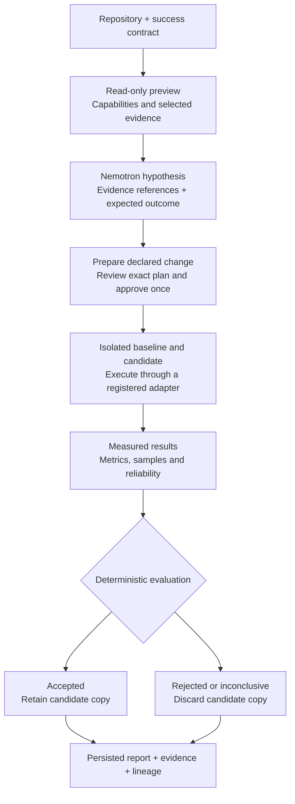
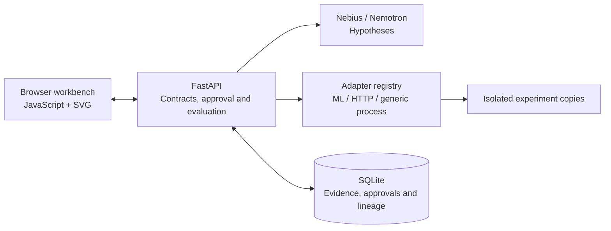

# ML Analyser

**License:** [Free use; permission required for code changes and redistribution](LICENSE).
This is source-available, **not open source**. [Hackathon eligibility implications](docs/LICENSING_DECISION.md).

[](https://github.com/Nbit-51/ML_ANALYSER/actions/workflows/ci.yml)

### From an optimization hypothesis to a measured engineering decision.

ML Analyser helps developers answer a concrete question: **did this change improve the project while preserving correctness?** It combines NVIDIA Nemotron reasoning with approval-gated experiments, baseline/candidate measurements and an inspectable evidence trail. ML is the flagship use case; the same engine also supports HTTP services and declared CLI, build, test-suite and microbenchmark harnesses.

Set a goal such as **lower validation RMSE** or **reduce P95 latency without changing the response**. Review the proposed explanation and declared configuration change, approve the experiment, then see what the measurements support: **accepted, rejected or inconclusive**.

**Nemotron reasons. Adapters measure. Deterministic rules decide.**

## Compare models from any project

Open **`/evaluate`** and supply a CSV of paired ground truth, baseline and candidate
predictions. Compare classifiers with F1/precision/recall and confusion matrices, or
regressors with MAE/RMSE. **Regression Radar** checks cohorts and class recall so a better
overall score cannot silently hide a failing segment. A paired bootstrap interval can
make an uncertain improvement inconclusive. No manifest, model upload or API key is needed.

Try **Find a hidden regression**: overall accuracy rises **78% → 90%**, but mobile accuracy
falls **90% → 60%**; the guardrail rejects the candidate. Export a report and recompute it
against your CSV using `python scripts/replay_predictions.py report.json predictions.csv`.
This evaluates supplied predictions; it does not train models or benchmark inference speed.
See [format, use cases and statistical limits](docs/PREDICTION_COMPARISON.md).

## Start with the Counterexample Lab

Open **`/lab`** for the public judge experience. NVIDIA Nemotron proposes a bounded cache
configuration; Python measures reference lookups and checks every price against an exact
reference on a fresh generated workload. Incorrect quotes become feedback for up to two
revisions, within one approved three-attempt campaign.

The demonstrated live run reduced lookups **120 → 30 (75%) with zero incorrect quotes**.
A declared product-only negative control reduced lookups further but returned **100 wrong
prices**, so the guardrail rejected it. These are synthetic benchmark work counts, not
production latency or dollar savings. The negative control is explicitly separate from the
model's proposal. Choose **Inspect a recorded live run** to inspect the captured evidence
without spending inference credits, or run the clearly labeled offline policy.

Download a capsule and independently recompute it without a model or API key:

```sh
python scripts/replay_capsule.py frontend/examples/cache-capsule-live.json
```

The checker verifies the committed challenge seed, benchmark source, every attempted
configuration, raw paired rounds, decisions and winner. The digest checks consistency;
it is not an authenticity signature. See [the lab protocol](docs/COUNTEREXAMPLE_LAB.md).

For a free public deployment, use [the deployment guide](docs/FREE_DEPLOYMENT.md).
The `judge` profile exposes the controlled lab and restricts the repository workbench.
Live lab inference defaults **off** and requires an explicit quota and host-managed secrets.

## Explore the experiment engine

The landing page uses a procedural Three.js graph to explain the experiment lifecycle: repository evidence, hypothesis, approval, baseline/candidate measurement and persisted decisions. Select nodes, explore outcome scenarios and compare explicitly labeled fixture reference values. The live workbench stays at `/app`.

The page includes mobile layouts, a motion pause control, reduced-motion support and a static fallback when WebGL2 is unavailable. Three.js and GSAP are pinned and served locally; normal app startup requires no frontend build. To reproduce the vendor assets, run `npm ci --ignore-scripts` followed by `npm run vendor:landing`. See [the visual system and storyboard](docs/VISUAL_SYSTEM.md).

## The model and its role

Our live reasoning configuration uses **NVIDIA Nemotron 3 Super 120B-A12B**, served through **Nebius Token Factory** as `nvidia/nemotron-3-super-120b-a12b`.

It is a **reasoning large language model (LLM)** with a hybrid **Mamba–Transformer, mixture-of-experts (MoE)** architecture: roughly **120 billion total parameters, with 12 billion active per token**. MoE activates a subset of the model's experts for each token. See [NVIDIA's model description](https://research.nvidia.com/labs/nemotron/Nemotron-3-Super/) and [Nebius's integration example](https://github.com/nebius/token-factory-cookbook/blob/main/models/nemotron/nemotron3-super-120B.md).

In this project, Nemotron reads bounded repository excerpts and the success contract, then returns structured, falsifiable hypotheses citing evidence IDs. We use the hosted model through its API; we do not train or fine-tune it. The model cannot execute commands, invent benchmark measurements or override the evaluator. A deterministic **mock provider** keeps demos and CI reproducible without credentials.

## How an experiment works



**Example: the HTTP fixture.** The contract asks for P95 latency at or below **40 ms**, an improvement of at least **10 ms**, **zero errors** and an **unchanged response hash**. The declared candidate reduces an artificial response delay. The adapter runs warm-ups and repeated request batches; the workbench displays latency distributions, guardrail results and reliability. These are demonstration targets, not promised benchmark results. A faster response alone is insufficient if correctness or reliability fails.

## What the reviewer can inspect

- **Repository understanding:** source-byte language composition, detected capabilities and explicit execution readiness.
- **Measurement quality:** baseline/candidate charts, absolute and percentage deltas, raw-sample distributions and variability.
- **Decision traceability:** objective and guardrail status, selectable experiment lineage, evidence records and persisted reports.
- **Controlled changes:** manifest-declared JSON configuration edits, fingerprint-bound approval and separate workspaces. Approval shows the exact executable changes and deterministic contract rules; model suggestions are labeled context. The original repository stays unchanged.



## Run locally

Use Python 3.11+ and Node.js for frontend tests.

```sh
python -m venv .venv
```

Activate with `.venv\Scripts\Activate.ps1` on Windows or `source .venv/bin/activate` on Linux, then run:

```sh
python -m pip install -e ".[dev]"
python -m uvicorn ml_analyser.main:app --app-dir backend --reload
```

Open [the landing page](http://127.0.0.1:8000/) or [the workbench](http://127.0.0.1:8000/app). [API docs](http://127.0.0.1:8000/docs). The mock provider works without an API key.

To enable live reasoning, copy [.env.example](.env.example) to `.env` **only if `.env` does not already exist**. Set `ML_ANALYSER_MODEL_PROVIDER=nebius`, your `NEBIUS_API_KEY`, and `NEBIUS_MODEL=nvidia/nemotron-3-super-120b-a12b`. Use the `NEBIUS_BASE_URL` for your Nebius region; the demonstrated configuration uses `https://api.tokenfactory.us-central1.nebius.com/v1`. Keep credentials local; `.env` is ignored. Live reasoning sends selected repository excerpts to Nebius.

Choose **My repository** to import a public GitHub URL or select a folder anywhere on your computer. Imports create managed source copies; originals stay unchanged. Local clones from other Git hosts work through folder import. Limits: 1,000 files, 2 MB per file and 20 MB total. Importing enables preview; execution still needs a supported manifest.

Your project list survives refreshes. Selecting a project loads its declared metrics. If its evaluations live in subfolders, choose one from **Evaluation project**. Completed reports can be reopened and downloaded from **Saved reports**. Importing arbitrary source does not create a dataset or an F1 benchmark: execution needs a supported evaluation manifest and compatible dependencies.

Choose **Try a guided demo** for an immediately runnable ML or HTTP example. Goal presets explain what better means, while optional targets and correctness limits stay out of the way until needed.

**GitHub sign-in:** configure the client ID, client secret and approved GitHub logins in your ignored local `.env`, or in **Render → Environment** for the deployed app, then restart/redeploy. `/login` shows the correct callback for that installation. Local demo access is available only in local mode; the public workbench requires sign-in. See [connection setup and verification](docs/CONNECTIONS.md) and [metric explanations and import limits](docs/ONBOARDING.md).

## Supported benchmarks

| Adapter | What it runs | Requirement |
| --- | --- | --- |
| ML training | Classification or declared custom metrics, including regression | `ml_experiment.json`; trusted local Python |
| HTTP backend | Warm-ups, repeated batches, latency percentiles, throughput and response integrity | `backend_benchmark.json`; trusted local Python |
| Generic process | CLI, test-suite, build and microbenchmark harnesses | `repo_benchmark.json`; Linux + bubblewrap |

Run the API inside Linux/WSL for generic execution. On Ubuntu, install the sandbox with `sudo apt-get install bubblewrap`; namespaces must be enabled. Windows supports generic preview, without automatic WSL dispatch. Start with the [CLI fixture](workspaces/cli-benchmark-demo) and [manifest guide](docs/GENERIC_BENCHMARKS.md).

Repository previews detect languages, build/test systems and capabilities without executing code. Detection alone does not establish execution support. Custom metrics, raw samples, evidence references and reports use the same normalized API across adapters.

## Verify

```sh
python -m ruff check .
python -m ruff format --check backend
python -m mypy backend/ml_analyser
python -m pytest --cov=ml_analyser --cov-report=term-missing --cov-fail-under=90
node --test frontend/*.test.js
```

Latest validation: **206 Linux tests passed, 94.54% coverage; all 34 frontend tests passed**. Browser checks cover accepted, rejected and inconclusive prediction comparisons, report export/replay and mobile layout. A live Nebius test imported this public repository and measured classifier F1 **0.667 → 1.000** on its small fixture dataset, with recall/accuracy guardrails satisfied. This validates the integration, not generalization to other datasets. See [validation evidence](docs/IMPLEMENTATION_VALIDATION.md). CI also checks JavaScript syntax and the packaged container.

## Boundaries

Execution requires fingerprint-bound, single-use approval. Generic execution denies external network access and enforces bounded commands, outputs and per-process resources. Legacy ML/HTTP runners are for trusted local code. Keep demo mode on localhost. GitHub sign-in restricts access to configured accounts; it does not turn trusted script execution into a hostile-code service.

This is a hackathon prototype: HTTP is sequential, ML training is not repeated, aggregate CPU/GPU/cost accounting is unavailable, and reliability rules do not establish statistical significance. Production workers, recovery and broader native ecosystem integrations remain future work.

Read [Architecture](docs/ARCHITECTURE.md), [Project context](docs/PROJECT_CONTEXT.md) and [Deployment/security](docs/DEPLOYMENT_AND_SECURITY.md) for details.
