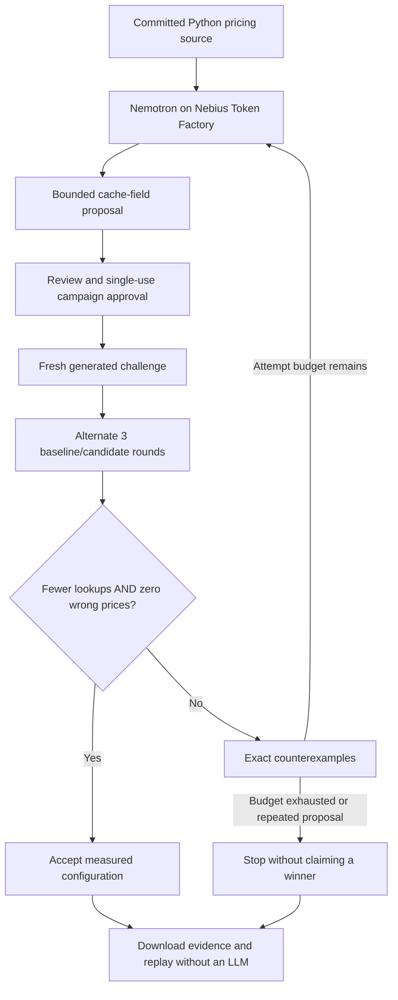

# Counterexample Lab

The lab makes one claim inspectable: a smaller work count is insufficient if the
optimization changes a correct answer. The intended audience is developers reviewing
AI-proposed performance changes in shared services.

## Executed workflow

The reference price depends on tenant, product and currency. The baseline calculates
every quote. A candidate adds a cache keyed by a nonempty subset of those fields. The
source is ordinary committed Python in `backend/ml_analyser/lab/workload.py`; no generated
code, `eval`, shell, visitor repository, or dependency installation is executed.

Discovery queries use one tenant and one currency. Challenges use new synthetic tenant
and product identities, two currencies and repeated requests. Before the first proposal
is approved, the server commits a random seed by SHA-256. Each attempt derives a distinct
workload from that seed and its attempt number. Previous failures may inform revisions;
the next actual queries have not been sent to the model. The seed is revealed at completion.
This is generated challenge testing, not a statistical generalization guarantee.

The shared deterministic evaluator minimizes `reference_lookups`, requires an improvement
of at least one lookup and applies the `incorrect_quotes == 0` guardrail. Three paired
rounds alternate execution order and reset caches. They establish reproducibility of
instrumented counts; they do not establish production speed or statistical significance.

## Model and evidence provenance

- Live reasoning: NVIDIA Nemotron 3 Super 120B-A12B through Nebius Token Factory.
- Output is validated against an enum of three fields and bounded text. Malformed output
  fails; no silent offline fallback occurs.
- One campaign permits at most three proposals, including the one generated at preparation.
  Repeated configurations stop the campaign. Provider failures preserve observed results.
- An unsafe `sku`-only cache is always measured as a **declared negative control**.
  It is not presented as a model mistake or an additional autonomous attempt.
- Offline mode deliberately uses scripted choices. Its measurements are real; its proposals
  are not model generated.
- `frontend/examples/cache-capsule-live.json` captures the real October 25 live browser
  campaign: one model call, 1,669 reported tokens, accepted on attempt one. It is displayed
  as recorded evidence, never a new inference or experiment. Its digest uses the same
  canonical numeric representation as browser exports; observations are unchanged.

Capsules contain the plan, source hash, seed commitment/reveal, control, every actual
attempt, raw counts, counterexamples, configuration diffs and verdicts. Replay regenerates
the input and compares all measurements and decisions. Digest consistency alone cannot
prove origin: a person who rewrites a file can also recompute its hash. The replayed
benchmark and its reference are inspectable code, not an independently certified oracle.

## Public deployment boundary

The lab API accepts only a proposal-source mode or an exact prepared plan plus approval.
Plans are browser-cookie-bound, expire after 15 minutes and execute once. SQLite serializes
quota reservations, and the evidence ledger retains attempts before revision calls.
The `judge` deployment profile blocks repository/import/run endpoints unless OAuth is
fully configured and the requester is an allowed account. Existing local workbench
features retain their original behavior.

Live inference defaults off. A configured daily limit bounds campaign reservations in
the current database. It is not a provider billing cap; free-host ephemeral disk loss
resets it. Use prepaid hackathon credits and provider-side limits where available.
Offline campaigns have a separate daily cap and do not spend model tokens. One process
is the supported demo topology; durable workers and production containment remain outside
this feature's claims.
